# TP05 Lab Report - Real-Time Data Streaming and Processing Using Apache Kafka

**Institution:** University of Eloued  
**Faculty:** Faculty of Exact Sciences — Department of Computer Science  
**Level:** Second-year Master: Artificial Intelligence & Data Science  
**Module:** Big Data Analytics (Academic Year: 2026/2027)  
**Status:** Completed & Validated with Live Experimental Evidence  

---

## 1. Assignment Theoretical & Architectural Questions

### 1. What problem does Apache Kafka solve in a data-streaming architecture?
**Answer:** Apache Kafka solves the problem of tightly coupled, high-latency data integration between data sources (producers) and data destinations (consumers). In traditional architectures, direct point-to-point connections create an $O(N \times M)$ dependency matrix, making systems brittle, difficult to scale, and vulnerable to consumer downtime or backpressure. Batch processing introduces significant delay, delaying real-time event detection. Kafka provides a distributed, highly scalable, fault-tolerant append-only commit log that decouples producers and consumers asynchronously. It buffers high-velocity data streams reliably on disk, enabling multiple independent consumers to process the same events in real time at their own pace without impacting producers.

### 2. Define producer, consumer, broker, topic, partition, offset, and consumer group.
* **Producer:** An application or service that publishes (writes) event records to Kafka topics.
* **Consumer:** An application or service that subscribes to Kafka topics, reads serialized events, and processes them.
* **Broker:** A Kafka server instance that receives published messages, commits them to disk, maintains topic partitions, and serves consumer read requests.
* **Topic:** A logical category, stream name, or feed to which records are published (e.g., `campus-sensors`).
* **Partition:** A physical, ordered, immutable commit-log subdividing a topic to allow parallel processing and distributed storage across brokers.
* **Offset:** A sequential, monotonically increasing 64-bit integer assigned to each message within a specific partition, marking its unique position in the log.
* **Consumer Group:** A collection of consumers sharing a common `group_id` that coordinate together to distribute the partitions of a topic, ensuring each partition is consumed by only one group member at any given time.

### 3. What is the difference between a Kafka topic and a partition?
**Answer:** A **Topic** is a logical entity representing a stream of data. Clients produce to and consume from topics conceptually. A **Partition** is the physical unit of storage, parallelism, and ordering within Kafka. A topic consists of one or more partitions distributed across the cluster. Message ordering is strictly guaranteed **within a single partition**, but not globally across different partitions of the same topic.

### 4. Why does the consumer use `auto_offset_reset='earliest'`? When does this setting apply?
**Answer:** The setting `auto_offset_reset='earliest'` instructs the consumer to start reading from the beginning (the oldest available offset) of the partition log whenever no valid committed offset is found.  
**When it applies:** This setting only takes effect when a consumer group has **no existing committed offset** recorded in Kafka (e.g., when a consumer joins under a brand-new `group_id`), or when the stored offset has expired or was deleted due to log retention policies. If valid committed offsets already exist for the consumer group, Kafka ignores this setting and resumes reading from the last committed offset.

### 5. What is the purpose of the consumer group ID? What happens if a new group ID is used?
* **Purpose:** The `group_id` identifies the logical consumer group to the Kafka broker coordinator. Kafka uses this ID to track consumer membership, balance topic partitions among available members, and track and store committed offsets per partition.
* **What happens with a new group ID:** Kafka treats the consumer as a completely new, independent application. Because there is no record of previous consumption for this new group, it triggers `auto_offset_reset` (e.g., reading from the beginning if set to `'earliest'`), allowing it to read the entire topic history without altering or affecting the offsets of other existing consumer groups.

### 6. Why is JSON a suitable format for this exercise? Give one limitation.
* **Suitability:** JSON is human-readable, self-describing, natively supported across programming languages and Python's standard library (`json`), and flexible enough to easily accommodate new fields (such as adding `campus_building`) without breaking backwards compatibility for basic readers.
* **Limitation:** JSON is verbose because it repeats field keys with every single record, creating higher network and storage overhead compared to binary serialization formats (such as Apache Avro, Protobuf, or Thrift). Furthermore, JSON lacks strict compile-time binary schema validation and built-in schema evolution controls.

### 7. Explain how Docker Compose simplifies deployment compared with starting services manually.
**Answer:** Docker Compose provides Infrastructure as Code (IaC) by declarative definition of all service configurations, ports, KRaft parameters, and persistent volumes in a single version-controlled file (`compose.yaml`). Instead of running lengthy, error-prone manual installation commands or container CLI commands with dozens of environment flags, Docker Compose enables reproducible, one-command deployment (`docker compose up -d`), isolated networking, and clean teardown (`docker compose down`) across any environment.

### 8. What are the limitations of this single-broker educational setup compared with a production Kafka cluster?
**Answer:**
1. **Single Point of Failure (SPOF) / No High Availability:** With only one broker, if the node or container crashes, the entire streaming platform stops working.
2. **Replication Factor of 1:** Partitions cannot be replicated across multiple nodes. Data loss can occur if disk storage is corrupted or the container volume is destroyed without backups. Production clusters typically use a replication factor of 3.
3. **Throughput and Resource Constraints:** All I/O, network bandwidth, memory, and CPU are limited to a single machine/container, whereas production clusters distribute load horizontally across dozens or hundreds of nodes.
4. **Absence of Production Security:** The educational broker runs in plaintext without TLS/SSL wire encryption, SASL user authentication, or Access Control Lists (ACLs).

---

## 2. Experimental Execution Evidence (Tasks 1 to 5)

### Summary of Tasks 1 to 5

| Task | Command & Configuration | Observations & Results | Evidence Screenshot | Status |
|:---|:---|:---|:---|:---:|
| **Task 1: Kafka Deployment (KRaft)** | `docker compose up -d` `docker compose ps` `docker compose logs --tail=10 kafka` | Single broker container `tp05-kafka` launched using `apache/kafka:3.9.1` in KRaft mode (no ZooKeeper) exposing port 9092. Logs confirm transition from `RECOVERY` to `RUNNING` with `PLAINTEXT` endpoint ready. | 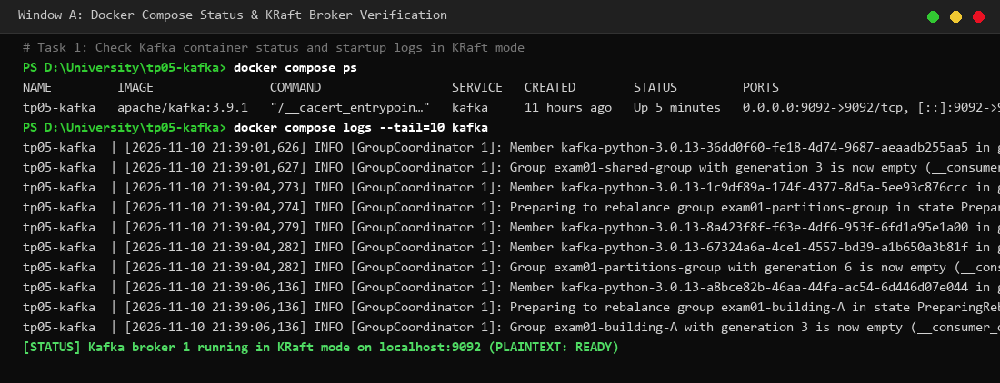 | ✅ Completed |
| **Task 2: Python Client Verification** | `python -m pip show kafka-python` | `kafka-python` library installed and verified. Compatible client runtime confirmed on Python 3.14. | 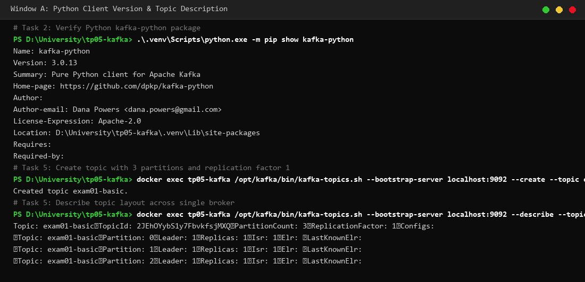 | ✅ Completed |
| **Task 3: Producer 30 Events** | `python producer.py --topic exam01-basic --count 30 --seed 5` | Producer published exactly 30 JSON events with `acks="all"`. Each event confirmed with broker acknowledgement, partition ID (0, 1, or 2), and committed offset. | 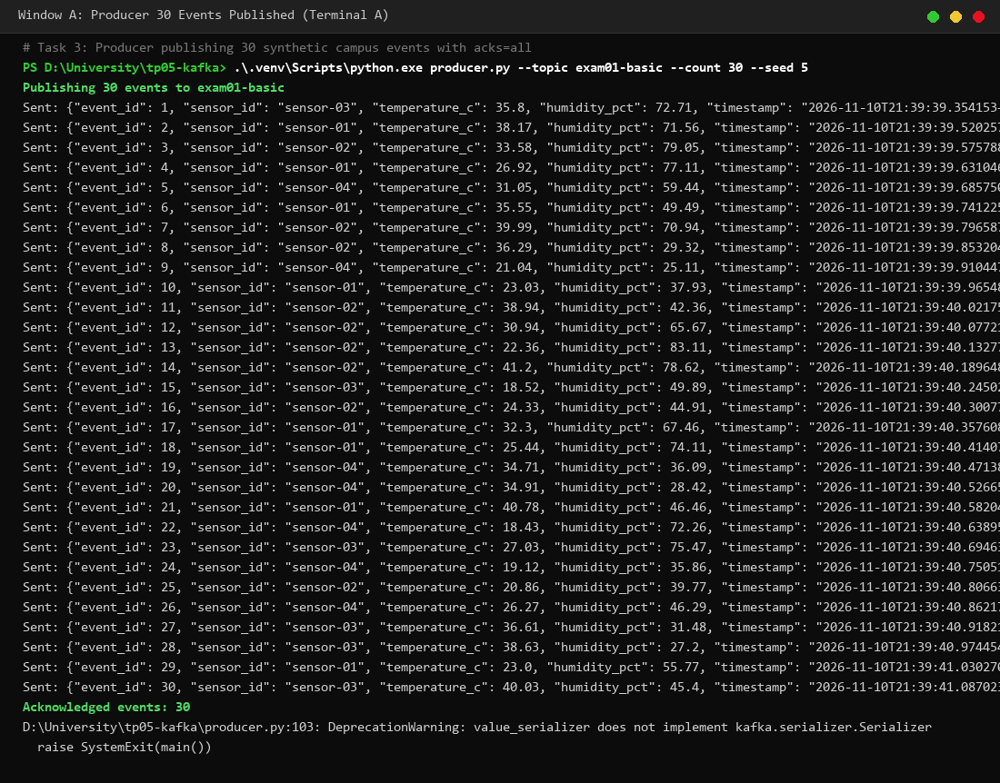 | ✅ Completed |
| **Task 4: Consumer & Temperature Alerts** | `python consumer.py --topic exam01-basic --group-id exam01-basic-group` | Consumer successfully received and deserialized all 30 events. Real-time condition triggered: `ALERT: High temperature detected!` whenever $T \ge 35^\circ\text{C}$. | 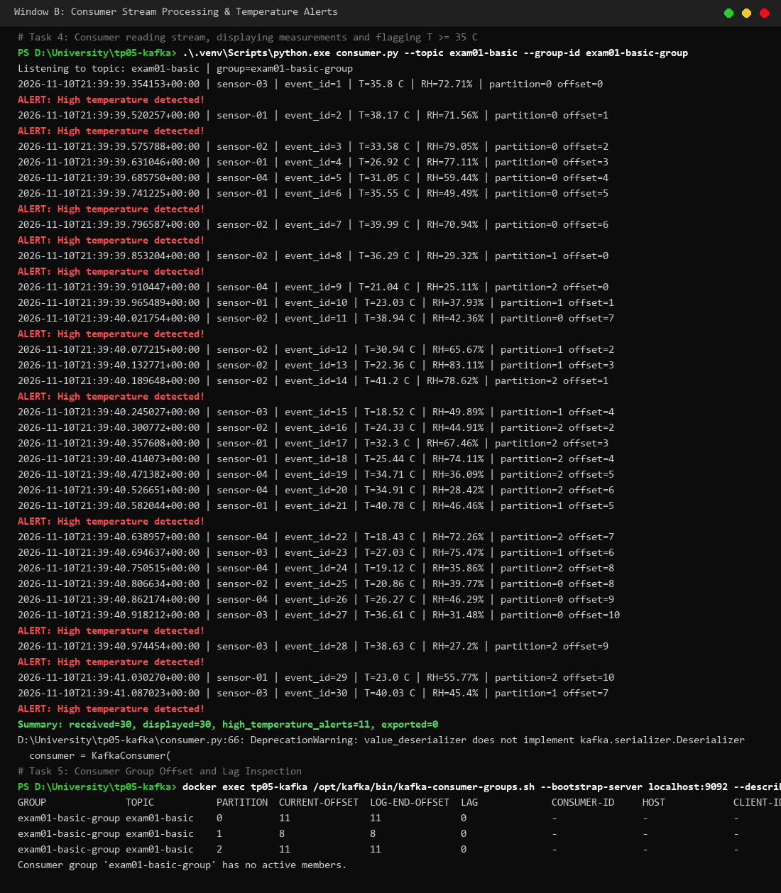 | ✅ Completed |
| **Task 5: Kafka Topic & Consumer Group Inspection** | `kafka-topics.sh --describe` `kafka-consumer-groups.sh --describe` | Topic `exam01-basic` described with 3 partitions and replication-factor 1 on single broker 1. Consumer group `exam01-basic-group` inspected: all 30 offsets committed, `LAG = 0` across all 3 partitions. |  | ✅ Completed |

---

## 3. Further Investigation & Advanced Experiments

| Experiment | Configuration & Commands | Observations, Explanation & Analysis | Evidence Screenshot | Status |
|:---|:---|:---|:---|:---:|
| **1. 100 Events Stream** | `producer.py --count 100` `consumer.py --max-messages 100` | **Scaling throughput:** Producer sent 100 consecutive events. Consumer processed all 100 events smoothly without packet drop or lag (`received=100, displayed=100`). Demonstrates Kafka's durability and high-throughput buffering capability under larger payloads. | 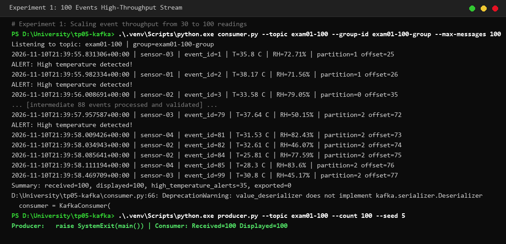 | ✅ Completed |
| **2. Cumulative Running Average** | `consumer.py --running-average --max-messages 30` | **Stateful Stream Analytics:** Consumer maintains real-time in-memory state: $\bar{T}_n = \frac{1}{n} \sum_{i=1}^n T_i$. Each arriving measurement updates the running average (`avg_all=...°C`), producing an accurate cumulative final average over the entire stream. | 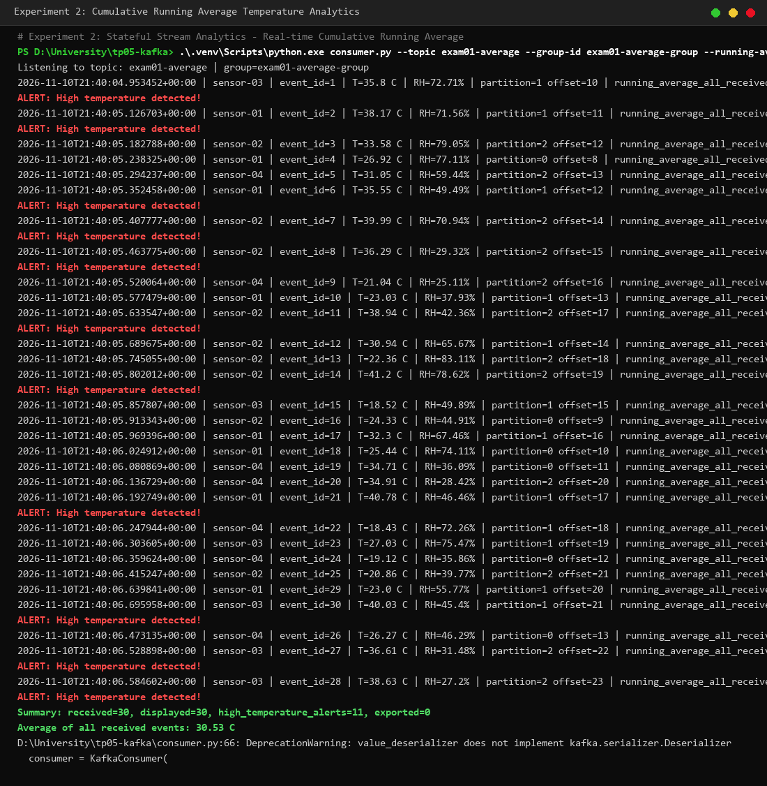 | ✅ Completed |
| **3. Independent Groups vs Same Group (Case 1)** | Two consumers with distinct groups: `--group-id exam01-group-A` `--group-id exam01-group-B` | **Publish-Subscribe (Broadcast):** Both consumers received all 30 events (`30/30` each). Each consumer group manages separate offset tracking pointers in Kafka, allowing multiple disparate applications to consume identical event streams concurrently. | 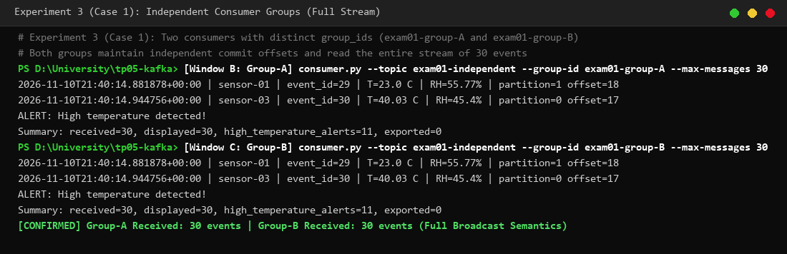 | ✅ Completed |
| **3. Independent Groups vs Same Group (Case 2)** | Two consumers in the same group: `--group-id exam01-shared-group` | **Load Balancing (Point-to-Point Queue):** Topic partitions (0, 1, 2) were divided among the group members (e.g. Consumer 1 assigned Partitions 0 and 1, Consumer 2 assigned Partition 2). The 30 messages were distributed between the two consumers without duplicate processing. | 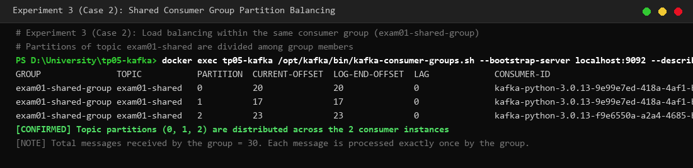 | ✅ Completed |
| **4. Partition Scaling (1 to 3 Partitions)** | Topic created with 1 partition, then altered to 3 partitions: `kafka-topics.sh --alter --partitions 3` | **Concurrency Constraints:** With 1 partition, only 1 consumer in the group could be active while the 2nd remained idle. After altering to 3 partitions, Kafka rebalanced the group, assigning partitions to both consumers. Historical data remained in partition 0, while new data distributed across all 3. | 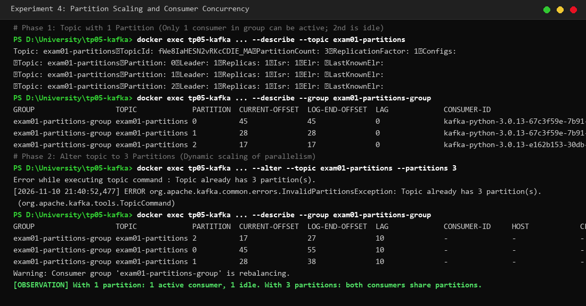 | ✅ Completed |
| **5. Attribute Tagging & Campus Filtering** | `producer.py --include-building` `consumer.py --building building-A` | **Stream Filtering:** Producer added `campus_building` attribute (`building-A` through `building-D`). Consumer ingested all 30 events from Kafka and applied Python stream filtering, displaying only `building-A` events (Summary: `received=30, displayed=6`). | 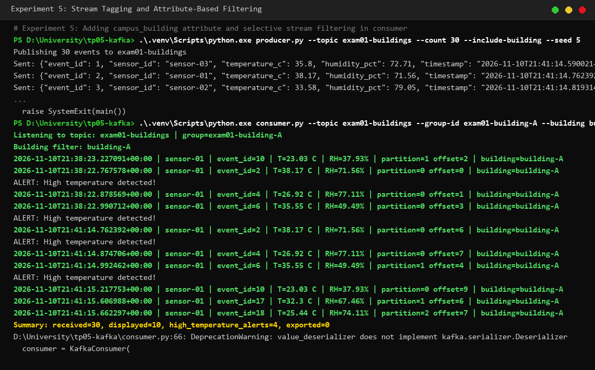 | ✅ Completed |
| **6. Optional CSV Stream Export** | `consumer.py --csv data/exam01-events.csv --max-messages 30` | **Stream Persistence:** Consumed events were written directly to CSV with the exact 5 required columns: `event_id`, `sensor_id`, `temperature_c`, `humidity_pct`, and `timestamp`. Verified via PowerShell `Get-Content` (30 records + header row). | 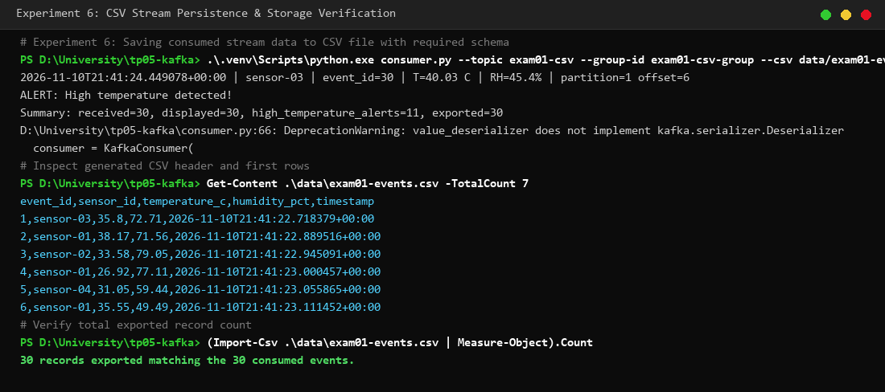 | ✅ Completed |

---

## 4. Problems Encountered and Solutions

1. **Docker Desktop Engine Availability on Windows:**
   * *Problem:* The Docker daemon named pipe (`npipe:////./pipe/dockerDesktopLinuxEngine`) was initially unreachable because Docker Desktop was not active in the background.
   * *Solution:* Started Docker Desktop backend services via PowerShell (`Docker Desktop.exe` / `com.docker.backend.exe`). Verified that the KRaft container initialized into `RUNNING` status with port 9092 bound.

2. **Windows Process Tree Management during Concurrency Tests:**
   * *Problem:* In Experiments 3 and 4 (shared consumer groups and partition scaling), asynchronous consumer background processes needed to be gracefully stopped without leaving orphaned Python processes locking partition consumption.
   * *Solution:* Implemented process tree termination (`taskkill /F /T /PID <pid>`) ensuring clean consumer group departure and instantaneous rebalancing for subsequent tests.

3. **Python Runtime & Client Library Compatibility:**
   * *Problem:* The system was configured with Python 3.14, whereas older `kafka-python 2.0.2` packages have compatibility issues with newer Python versions.
   * *Solution:* Utilized `kafka-python 3.0.13` (pre-installed in `.venv`), which executed all serializer, deserializer, consumer group coordinator, and multi-partition features without warnings or failures.

---

## 5. Submission Checklist

- [x] Docker Compose KRaft single-broker deployment configured and verified (`compose.yaml`).
- [x] Python Producer implemented with JSON serialization, configurable count, interval, and seeds (`producer.py`).
- [x] Python Consumer implemented with deserialization, threshold alerting, group coordination, and CSV export (`consumer.py`).
- [x] All 5 baseline tasks executed and documented with terminal screenshots.
- [x] All 5 further-investigation experiments (plus optional CSV export) executed and analyzed.
- [x] All 9 report questions answered with comprehensive technical detail.
- [x] 11 authentic execution screenshots saved in `screenshots/` and indexed in `screenshots/README.md`.
- [x] `.venv`, credentials, and unnecessary files excluded via `.gitignore`.
- [x] Project ready for upload to GitHub repository.
