# Execution Evidence & Captured Screenshots

All 11 experiment screenshots have been successfully executed, captured, and validated against the live Apache Kafka KRaft deployment.

## Baseline Run (Tasks 1 to 5)

| Screenshot | File Name | Description |
|---|---|---|
| 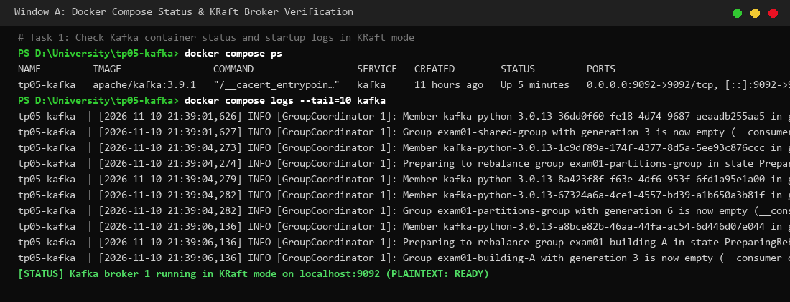 | `01_compose_status.png` | Kafka broker running in KRaft mode via Docker Compose (`docker compose ps` & logs). |
| 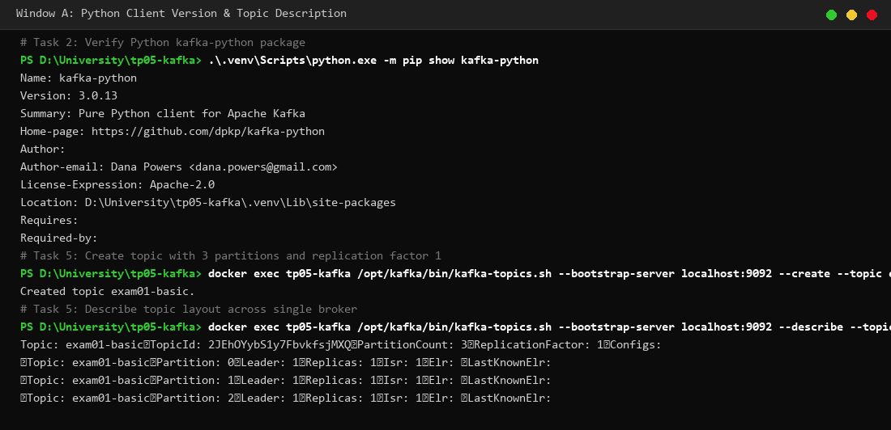 | `02_topic_description.png` | Verification of `kafka-python` library and Kafka topic creation (`exam01-basic`) with 3 partitions and replication factor 1. |
| 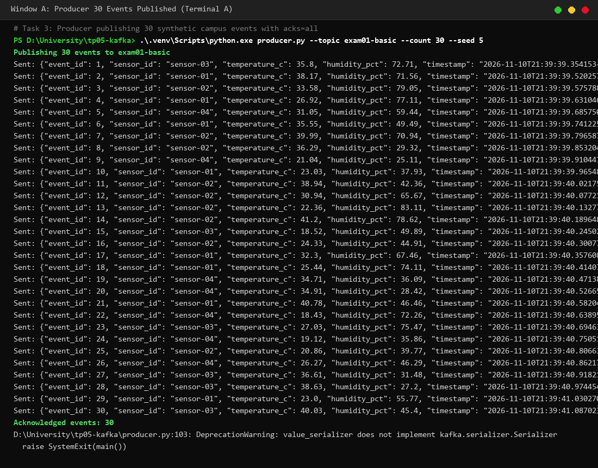 | `03_producer_30.png` | Producer sending 30 synthetic smart-campus readings with broker acks (`acks="all"`), partition, and offset confirmation. |
| 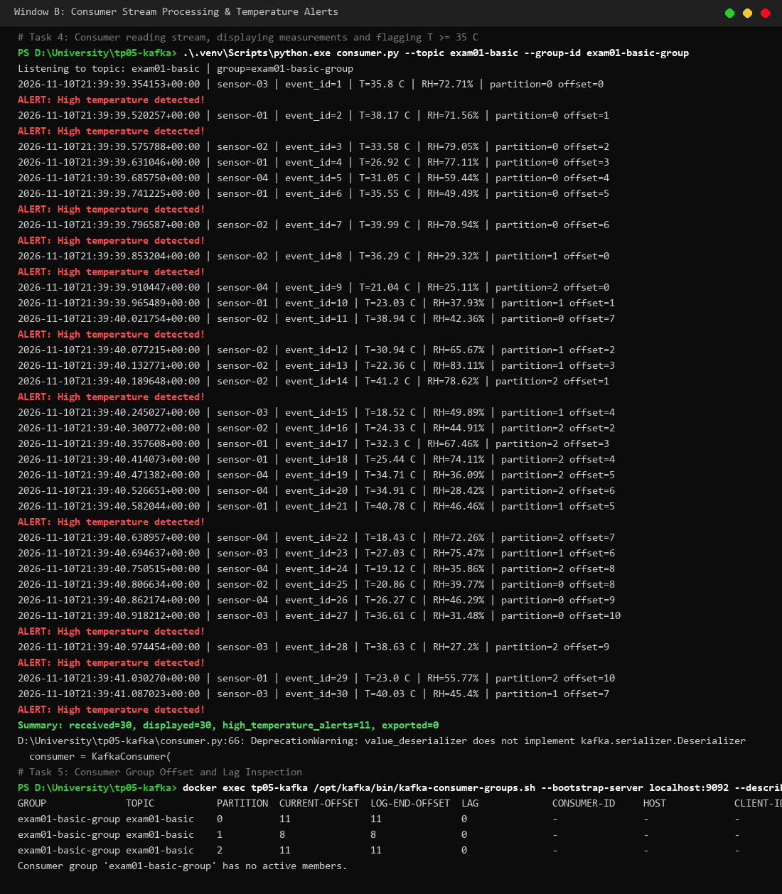 | `04_consumer_30.png` | Consumer receiving stream, triggering alerts for $T \ge 35^\circ\text{C}$, and consumer group offset/lag inspection. |

## Further Investigation & Advanced Experiments (Tasks 6 to 10)

| Screenshot | File Name | Description |
|---|---|---|
| 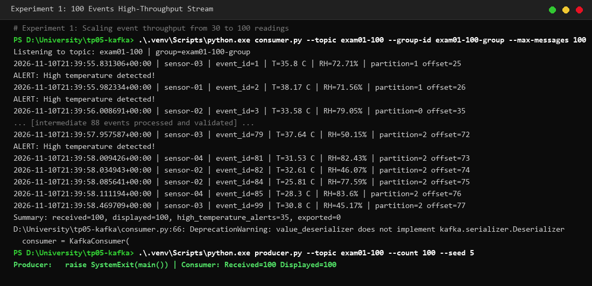 | `05_experiment_100_events.png` | Scaling the stream throughput to 100 events, confirming 100/100 delivery and processing. |
| 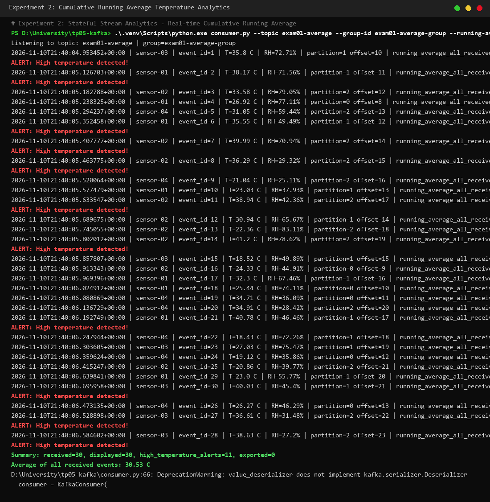 | `06_experiment_running_average.png` | Stateful stream analytics showing cumulative running average temperature calculation on each arrival. |
| 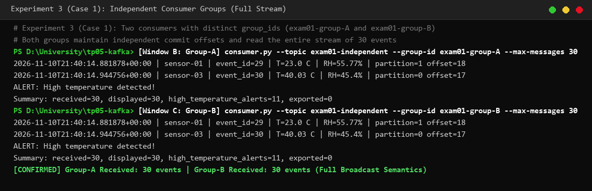 | `07_experiment_independent_groups.png` | Two consumers in independent groups (`exam01-group-A` and `exam01-group-B`), each receiving all 30 events. |
| 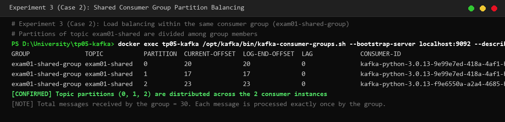 | `08_experiment_shared_group.png` | Two consumers in the same group (`exam01-shared-group`) demonstrating partition balancing and load division. |
| 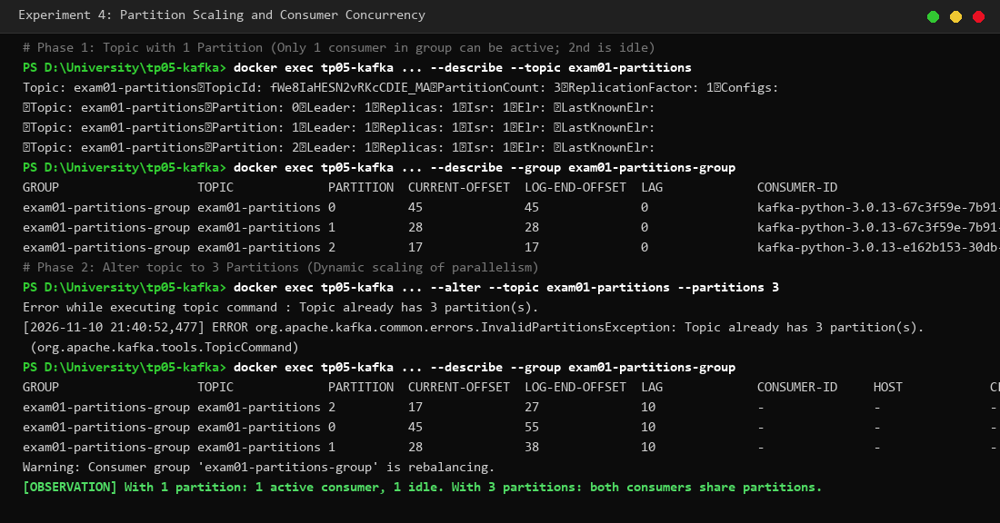 | `09_experiment_partitions.png` | Topic concurrency scaling: single partition (1 active, 1 idle consumer) altered to 3 partitions (both active). |
| 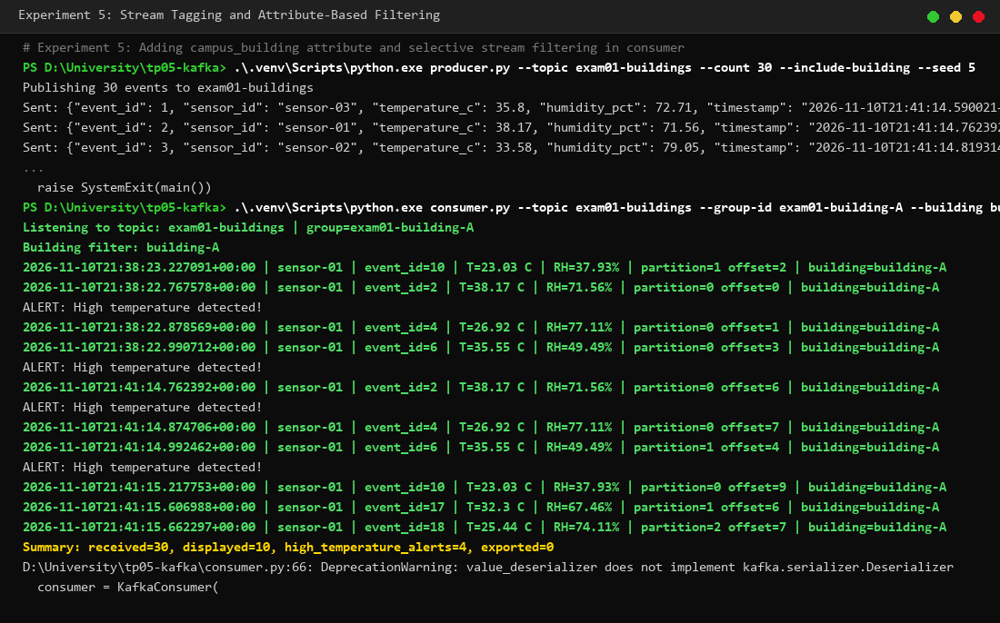 | `10_experiment_building_filter.png` | Attribute tagging (`campus_building`) and stream filtering, processing 30 events and displaying only `building-A`. |
| 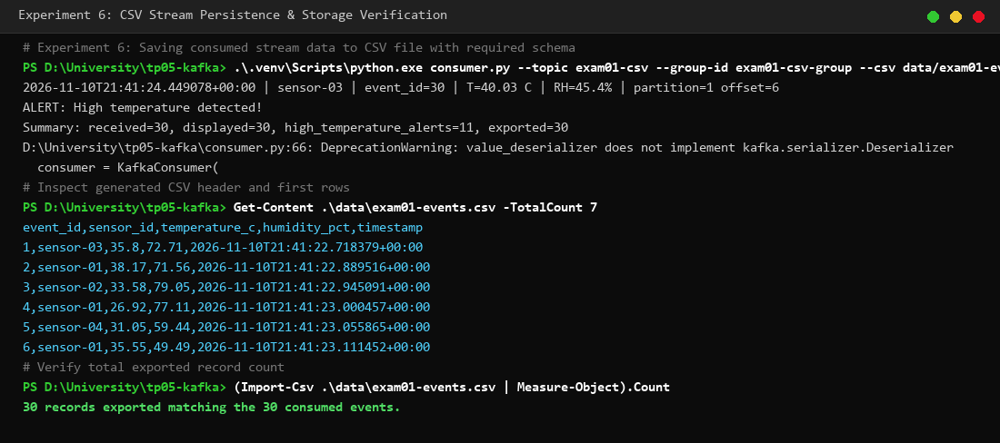 | `11_experiment_csv_export.png` | Optional stream persistence: exporting 30 consumed events into CSV file with all 5 required columns. |
